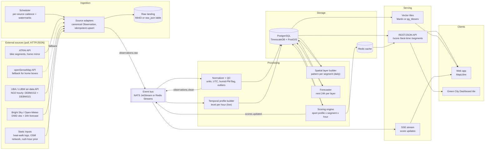

I'll pull the two pages you linked first so the source list matches what's actually offered.

Short version first, then the detail. I'm assuming hackathon scope: a small team, must be demoable in days, and the scoring formula will change repeatedly while you work. That assumption drives most choices below; say so if it's wrong.

## Protocol: gRPC vs webhooks is the wrong axis here

None of your sources push to you. openSenseMap, the ATRAI platform, the UBA/LUBW air-data API and Bright Sky are all pull-based HTTP/JSON. Webhooks are therefore not an option for ingestion (I'm not aware of any of these offering subscriptions; verify if you care), and gRPC only matters for traffic between your own services. The real decision is **polling adapters → event bus → workers**, with plain REST + SSE toward the browser.

| Option | Use it for | Trade-off |
|---|---|---|
| HTTP polling (JSON/GeoJSON) | External sources → adapters | Only thing the sources support. Latency = poll interval, which is fine: NO2 is hourly anyway, home boxes report every few minutes. |
| Event bus (NATS JetStream or Redis Streams) | Adapters → processing → serving | Replay and fan-out, which you need because you'll re-score everything each time the formula changes. One extra container. |
| REST/JSON + SSE | API → web client | Works everywhere, cacheable, curl-debuggable. Typed contract via OpenAPI. |
| gRPC | Scoring engine ↔ API, only if they're separate processes in different languages | Typed streaming, but proto toolchain, no browser access without grpc-web + Envoy, and painful to debug at 3 a.m. Skip unless you have a Go/Rust scoring service. |
| Webhooks (outbound) | Later: "it's a good hour to run now" push notifications | Not an ingestion mechanism in this project. |

If you want gRPC-style typing without gRPC, put protobuf or JSON-Schema messages on the bus; that's where contracts actually pay off.

## Sources, as they actually exist

- **senseBox:home**: the hackathon provides a Heilbronn-wide endpoint at api.atrai.bike (collection osem_home_data_heilbronn, GeoJSON) covering all registered boxes. Prefer this over openSenseMap directly, because the organisers note the current openSenseMap is approaching end-of-life and may be slow or unresponsive. Keep the openSenseMap box endpoint (`api.opensensemap.org/boxes/{id}`) as a fallback with a circuit breaker.
- **senseBox:bike (ATRAI)**: already street-matched. Every measurement is assigned to the nearest OSM street segment within 20 m and averaged per segment. Relevant collections: bumpy_roads_heilbronn (~9,400 segments, roughness 0–1), danger_zones_heilbronn (~6,500 overtaking risk points), overtaking_distance_heilbronn (~1,300 segments), plus `traffic_flow_<city>` and `road_network_<city>`. This is your cyclist safety/surface layer almost for free.
- **NO2 Weinsberger Straße**: the LUBW traffic station is DEBW152 Heilbronn Weinsberger Straße-Ost, classified as urban traffic; the urban-background station is DEBW015 Heilbronn, Hans-Rießer-Straße 7. Hourly values are retrievable from the Umweltbundesamt air-data API (`/api/air_data/v3/measures/...`); station codes like DEBW019 can be used instead of numeric IDs, and NO2 is component 5. Please verify the scope parameter for hourly data; sources I found disagree on whether it's 1 or 2. Ingest both stations: NO2(traffic) − NO2(background) is a cleaner traffic tracer than the raw value.
- **Weather/forecast**: Bright Sky or Open-Meteo (both listed by the organisers) for DWD observations and the next-24h temperature forecast.
- **Static**: the Heat-Island summer-school walk logs, rush-hour prior as a config file.

One gap: I did not find hourly bike counts in the hackathon material. ATRAI has per-ride tracks and per-segment averages, not counter stations. If your counts come from OpenData Heilbronn or MobiData BW, tell me which dataset and I'll fit the adapter.

## Services

1. **Scheduler** – cron/APScheduler; triggers adapters at per-source cadence (home boxes 5 min, UBA 20 min, weather 30 min, ATRAI segments daily).
2. **Source adapters** – one per source, all emitting one canonical `Observation {source, station_id, geom, phenomenon, value, unit, ts_utc, qc_flags}`. Store a watermark per source so restarts backfill gaps; upsert on `(station_id, phenomenon, ts)` so re-polling is idempotent.
3. **Raw landing** (MinIO/S3 or a `raw_json` table) – keep every payload. You will reprocess.
4. **Normalizer + QC** – units, UTC, stuck-sensor detection, humidity flag. ATRAI's own pipeline drops PM readings above 75% humidity and outliers; copy that rule.
5. **Spatial layer builder** – per OSM segment: heat anomaly, PM pattern, roughness, overtaking risk. Runs rarely (daily).
6. **Temporal profile builder** – city-level "level by hour": NO2, PM, temperature, rush prior. Runs on every clean observation.
7. **Forecaster** – next 24h per layer, from DWD forecast + hour-of-day/weekday climatology learned from your own NO2/PM history.
8. **Scoring engine** – per sport profile × segment × hour. Precompute; ~9,400 segments × 24 h × 3 profiles ≈ 680k rows/day, trivial for Postgres.
9. **API** – FastAPI (or similar): `/score?lat,lon,t`, `/best-time?segment`, `/segments?bbox`; vector tiles via Martin or pg_tileserv; SSE for live score updates.
10. **Storage** – one PostgreSQL with TimescaleDB + PostGIS. One DB for time series and geometry is the biggest simplification you can buy.

The design trick that makes "where" and "when" cheap: **score = spatial pattern × temporal level**. Mobile data (bikes, walks) gives the slow-changing *pattern* across streets; stationary data (home boxes, LUBW, DWD) gives the fast-changing *level* per hour. Segments without bike coverage fall back to IDW from stationary boxes or the city level, with a confidence field so the UI can grey them out.

## Architecture

Communication summary: solid arrows into adapters are HTTP polling; adapters → bus → workers is async messaging; everything touching TSDB is SQL; serving to clients is REST + MVT tiles + SSE. No gRPC anywhere unless you split SCORE into its own non-Python process.

Two things I'd like from you before going deeper: where the hourly bike counts come from, and whether you'd rather start as a single Python process with modules (fastest path, same diagram, bus swapped for in-process queues) and only split into containers once it works.